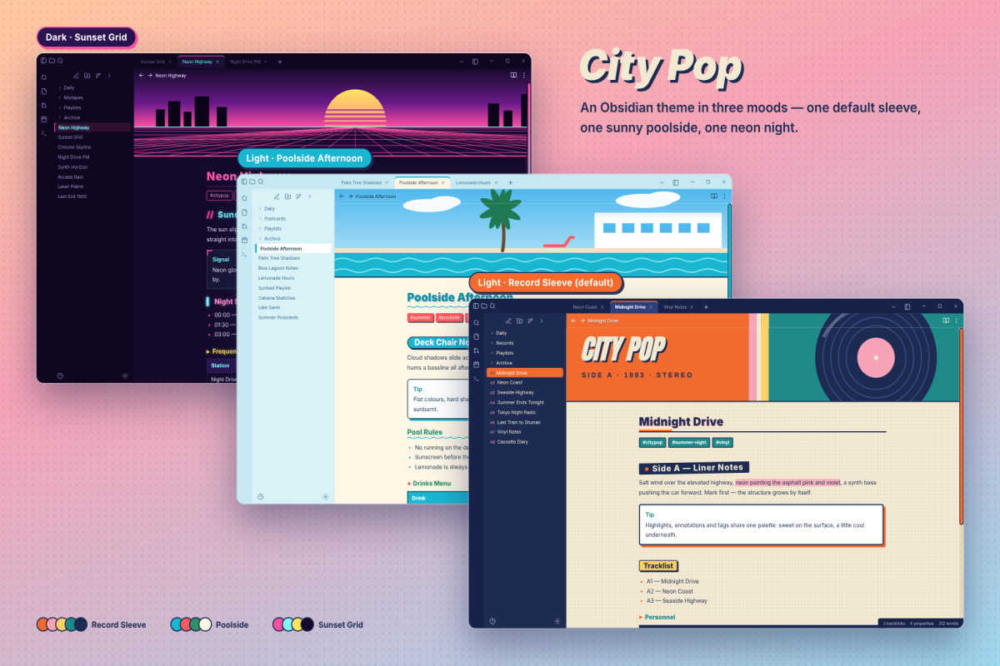

# City Pop

一套为 Obsidian 打造的 80 年代 City Pop 复古主题，包含**三套精调配色**：两张浅色（唱片封套 / 泳池午后）与一张暗色（日落网格），将黑胶唱片、泳池午后与霓虹夜色的视觉谱系搬进笔记。

> A retro City Pop theme for Obsidian with **three carefully tuned color schemes** — two light variants (Record Sleeve / Poolside Afternoon) and one dark (Sunset Grid), bringing the vinyl record, poolside afternoon and neon night aesthetics into your notes.

## 截图 / Screenshots

## 配色方案 / Color Schemes

| 方案 | 模式 | 背景 | 文字 | 强调色 |
|------|------|------|------|--------|
| C · 唱片封套（默认） | 浅色 | `#f3e9d2` 米黄纸底 | `#1d2b53` 藏蓝 | `#f26a2e` 活力橙 · `#1f8a8a` 青绿 |
| A · 泳池午后 | 浅色 | `#fff6e5` 奶油白 | `#1c3a52` 海军蓝 | `#0e8fa8` 海青 · `#ff5a5f` 珊瑚红 |
| B · 日落网格 | 暗色 | `#150a2b` 深紫夜 | `#efe6ff` 浅紫白 | `#ff4fa3` 霓虹粉 · `#7df9ff` 霓虹青 |

> Scheme C · Record Sleeve (default light): warm cream paper, navy ink, orange & teal accents. Scheme A · Poolside Afternoon (light): soft cream & pool blue, coral accents. Scheme B · Sunset Grid (dark): deep purple night with neon pink & cyan.

## 特色 / Features

- **三套配色一键切换**：通过 [Style Settings](https://github.com/mgmeyers/obsidian-style-settings) 插件在浅色双方案间切换，暗色方案随 Obsidian 模式自动生效
- **专属唱片横幅**：每套方案配一幅手绘 SVG 横幅（黑胶唱片 / 泳池场景 / retrowave 日落），显示在笔记顶部，可在 Style Settings 中隐藏
- **曲目编号文件列表**：侧栏文件树带序号编号，像唱片背面曲目单
- **80 年代印刷细节**：标题装饰符号（● ▶ // ▍）、轻微倾斜的 H2、硬阴影按钮与标签；暗色方案切换为霓虹发光
- **霓虹 Callout**：暗色模式下 callout 带四角折角与霓虹描边，浅色下为纸张质感白卡

> Switch between light variants via the Style Settings plugin; the dark scheme applies automatically. Each scheme ships a hand-drawn SVG banner (vinyl / poolside / retrowave sunset) shown atop notes and can be hidden. Sidebar file list carries track-style numbering. 80s print details: decorated headings, slightly tilted H2, hard-shadow buttons & tags — all turning neon glow in dark mode. Neon cornered callouts in dark mode.

## 插件推荐 / Recommended Plugin

- [SwiftSwitch](https://community.obsidian.md/plugins/swift-snippets) — 在标签页上快速切换主题与配色方案

> [SwiftSwitch](https://community.obsidian.md/plugins/swift-snippets) — quickly switch themes and color schemes right from the tab bar

## 安装 / Install

**社区主题商店**：设置 → 外观 → 主题 → 管理 → 浏览 → 搜索 "City Pop" → 安装并启用。

**手动安装**：下载 `theme.css` 与 `manifest.json`，放入仓库的 `.obsidian/themes/City Pop/` 文件夹，然后在外观设置中启用。

> **Community themes**: Settings → Appearance → Themes → Manage → Browse → search "City Pop" → Install & Enable. **Manual**: download `theme.css` and `manifest.json` into `.obsidian/themes/City Pop/` inside your vault, then enable it in Appearance settings.

